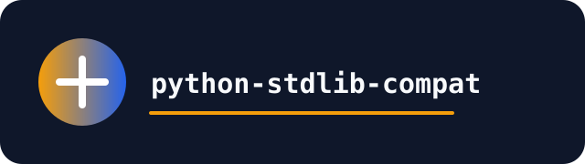

<p align="center"></p>
<p align="center"></p>
<p align="center">   </p>
<p align="center"></p>

## 🧭 Overview

`python-stdlib-compat` scans Python source without importing or executing it. A curated rule set identifies selected standard-library modules and symbols added after your declared minimum Python version.

## ✨ Features

- 🧭 Checks imports against a chosen target version
- 🔍 Recognizes selected module and symbol introduction versions
- 🛡️ Parses source with `ast`; project code is never imported or executed
- 📄 Supports readable text and machine-readable JSON reports
- ⚙️ Skips common virtual-environment and cache folders

## 🧪 Demo

Run `python main.py sample --target 3.10`. The sample imports `tomllib`, which entered the standard library in Python 3.11. No hosted demo is published.

## 🚀 Quick Start

```bash
python main.py sample --target 3.10
python main.py ./src --target 3.11 --json
python -m unittest discover -s tests
```
The tool uses only the standard library. Python 3.10 or newer is recommended.

## 🧰 Tech Stack

- **Stack:** Python 3.10+ (standard library only)
- **Approach:** small, local-first tooling with clear output

## 🗂️ Folder Structure

```text
python-stdlib-compat/
├── assets/mark.svg
├── sample/app.py
├── tests/test_main.py
├── main.py
├── pyproject.toml
├── .gitignore
├── LICENSE
└── README.md
```

## 🛣️ Roadmap

- Expand the curated compatibility database with reviewed API-level rules
- Add SARIF output for code-scanning workflows

## 🤝 Contributing

Issues and focused pull requests are welcome. Explain the use case, keep changes small, and add tests for behavior changes. Run the project using the Quick Start instructions before submitting.

## 📄 License

Released under the [MIT License](LICENSE).

<p align="center"></p>
